<!-- ═══════════════════════════ HEADER ═══════════════════════════ -->
<div align="center">


<p>
  <a href="https://linkedin.com/in/youssif-ashmawy"></a>
  <a href="mailto:ashmawyyoussif@gmail.com"></a>
  <a href="https://youssif-ashmawy.github.io/Portfolio/"></a>
</p>

</div>

---

<!-- ═══════════════════════════ ABOUT ═══════════════════════════ -->
## 💫 About Me

<table>
<tr>
<td width="55%" valign="top">

I'm an **MLOps & LLMOps Engineer** focused on building, deploying, optimizing, and maintaining AI systems in production.

My focus isn't just on *training* models; it's on **deploying, monitoring, and maintaining** them where it matters: in production. I love turning ideas into **end-to-end systems**, from data ingestion and RAG pipelines all the way to deployment and automation.

Before anything ships, I make sure it's worth shipping: I **tune hyperparameters** to squeeze out performance and run **thorough evaluation suites** so every model is measured, compared, and proven, not just assumed to work.

- 🤖 &nbsp;**AI & Machine Learning** - PyTorch, TensorFlow, scikit-learn, OpenCV
- ☁️ &nbsp;**Cloud & Distributed Systems** - AWS, OpenStack, Kubernetes
- 📦 &nbsp;**MLOps & LLMOps** - reproducible, observable, production-ready pipelines
- 🎯 &nbsp;**Model Optimization** - hyperparameter tuning for accuracy, latency & cost
- 🧪 &nbsp;**Evaluation & Testing** - benchmark, regression & LLM quality evals
- ⚡ &nbsp;**GPU Computing** - CUDA-accelerated workloads

</td>
<td width="45%" valign="top">

```python
class YoussifAshmawy:
    role     = "MLOps & LLMOps Engineer"
    focus    = ["LLMs", "Model Serving",
                "Hyperparameter Tuning",
                "Evals", "Cloud Infra", "Automation"]
    pipeline = ("data → train → tune → eval"
                " → deploy → monitor")
    stack    = {
        "ml":     ["PyTorch", "TensorFlow", "MLflow"],
        "quality":["HPO sweeps", "eval suites"],
        "infra":  ["Docker", "Kubernetes", "AWS"],
        "serve":  ["FastAPI", "Flask", "Nginx"],
        "observe":["Grafana"],
    }

    def motto(self):
        return "If it's not in prod, it's a demo."
```

</td>
</tr>
</table>

---

<!-- ═══════════════════════════ PIPELINE ═══════════════════════════ -->
## 🔁 How I Ship ML

<div align="center">
  
</div>

<p align="center"><sub>👇 Click any stage to see how I handle it</sub></p>

<details>
<summary><b>01 · 📥 Ingest</b> — getting reliable data in</summary>
<br/>

Pull from APIs, files and databases (**PostgreSQL**, **MySQL**, **SQLite**), validate schemas early, and version raw data so every model can be traced back to its inputs.
</details>

<details>
<summary><b>02 · 🧹 Process</b> — turning raw data into features</summary>
<br/>

Clean, transform and engineer features with **Pandas** and **NumPy**. For LLM work: chunking, embedding and indexing documents for **RAG pipelines**.
</details>

<details>
<summary><b>03 · 🧠 Train & Tune</b> — building the model, then making it better</summary>
<br/>

Train and fine-tune with **PyTorch**, **TensorFlow** and **scikit-learn**, with **CUDA** acceleration on NVIDIA GPUs and **OpenCV** for vision tasks. Then run **hyperparameter sweeps** (learning rate, batch size, architecture and generation settings) to optimize for accuracy, latency and cost, not just the first config that worked.
</details>

<details>
<summary><b>04 · 🧪 Evaluate</b> — proving it works before it ships</summary>
<br/>

Run **evaluation suites** on every candidate: benchmark metrics, regression tests against the current production model, and **LLM evals** for answer quality, hallucinations and RAG retrieval accuracy. Results are logged in **MLflow**, and only models that pass the gate get promoted, never a folder called <code>final_v2_REAL</code>.
</details>

<details>
<summary><b>05 · 🐳 Containerize</b> — packaging for anywhere</summary>
<br/>

Wrap models in **FastAPI** / **Flask** services and ship them as lean **Docker** images that behave the same on a laptop and in the cluster.
</details>

<details>
<summary><b>06 · ⚙️ CI / CD</b> — automating the boring parts</summary>
<br/>

**GitHub Actions** runs tests, builds images and deploys on every merge, so shipping a new model is a pull request, not a ceremony.
</details>

<details>
<summary><b>07 · ☸️ Deploy</b> — serving at scale</summary>
<br/>

Roll out on **Kubernetes** across **AWS** and **OpenStack**, behind **Nginx**, with scaling and rollbacks built in.
</details>

<details>
<summary><b>08 · 📈 Monitor</b> — watching it in production</summary>
<br/>

Track latency, errors and data drift in **Grafana** dashboards. When drift shows up, it feeds back into processing and retraining — closing the loop.
</details>

---

<!-- ═══════════════════════════ TECH STACK ═══════════════════════════ -->
## 🛠️ Tech Stack

<div align="center">

### 🧠 AI / ML & Data

<br/>


### ☁️ Cloud, DevOps & MLOps

<br/>


### 💻 Languages


### 🌐 Backend, Frontend & APIs

<br/>


### 🗄️ Databases


### 🧰 Tools

<br/>


</div>

---

<!-- ═══════════════════════════ STATS ═══════════════════════════ -->
## 🐍 Contribution Grid

<div align="center">

<picture>
  <source media="(prefers-color-scheme: dark)" srcset="https://raw.githubusercontent.com/Youssif-Ashmawy/Youssif-Ashmawy/output/github-snake-dark.svg" />
  <source media="(prefers-color-scheme: light)" srcset="https://raw.githubusercontent.com/Youssif-Ashmawy/Youssif-Ashmawy/output/github-snake.svg" />
  
</picture>

</div>

---

<!-- ═══════════════════════════ FOOTER ═══════════════════════════ -->
<div align="center">

### 🤝 Let's Build Something

Open to collaborations on **MLOps**, **LLM/RAG systems**, **model optimization & evaluation**, and **cloud-native AI**.
<br/>Reach out on [LinkedIn](https://linkedin.com/in/youssif-ashmawy) or drop me an [email](mailto:ashmawyyoussif@gmail.com).


</div>
