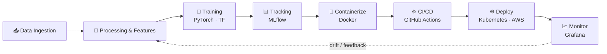

<!-- ═══════════════════════════ HEADER ═══════════════════════════ -->
<div align="center">


<a href="https://git.io/typing-svg">
  
</a>

<p>
  <a href="https://linkedin.com/in/youssif-ashmawy"></a>
  <a href="mailto:ashmawyyoussif@gmail.com"></a>
  <a href="https://youssif-ashmawy.github.io/Portfolio/"></a>
  
</p>

</div>

---

<!-- ═══════════════════════════ ABOUT ═══════════════════════════ -->
## 💫 About Me

<table>
<tr>
<td width="55%" valign="top">

I'm an **MLOps Engineer** who builds intelligent, scalable systems that bridge **AI**, **cloud infrastructure**, and **real-world applications**.

My focus isn't just on *training* models — it's on **deploying, monitoring, and maintaining** them where it matters: in production. I love turning ideas into **end-to-end systems**, from data ingestion and RAG pipelines all the way to deployment and automation.

- 🤖 &nbsp;**AI & Machine Learning** — PyTorch, TensorFlow, scikit-learn, OpenCV
- ☁️ &nbsp;**Cloud & Distributed Systems** — AWS, OpenStack, Kubernetes
- 📦 &nbsp;**MLOps** — reproducible, observable, production-ready pipelines
- ⚡ &nbsp;**GPU Computing** — CUDA-accelerated workloads

</td>
<td width="45%" valign="top">

```python
class YoussifAshmawy:
    role     = "MLOps Engineer"
    focus    = ["LLMs & RAG", "Model Serving",
                "Cloud Infra", "Automation"]
    pipeline = "data → train → deploy → monitor"
    stack    = {
        "ml":     ["PyTorch", "TensorFlow", "MLflow"],
        "infra":  ["Docker", "Kubernetes", "AWS"],
        "serve":  ["FastAPI", "Flask", "Nginx"],
        "observe":["Grafana"],
    }

    def motto(self):
        return "If it's not in prod, it's a demo."
```

</td>
</tr>
</table>

---

<!-- ═══════════════════════════ PIPELINE ═══════════════════════════ -->
## 🔁 How I Ship ML



---

<!-- ═══════════════════════════ TECH STACK ═══════════════════════════ -->
## 🛠️ Tech Stack

<div align="center">

### 🧠 AI / ML & Data

<br/>


### ☁️ Cloud, DevOps & MLOps

<br/>


### 💻 Languages


### 🌐 Backend, Frontend & APIs

<br/>


### 🗄️ Databases


### 🧰 Tools

<br/>


</div>

---

<!-- ═══════════════════════════ STATS ═══════════════════════════ -->
## 🐍 Contribution Grid

<div align="center">

<picture>
  <source media="(prefers-color-scheme: dark)" srcset="https://raw.githubusercontent.com/Youssif-Ashmawy/Youssif-Ashmawy/output/github-snake-dark.svg" />
  <source media="(prefers-color-scheme: light)" srcset="https://raw.githubusercontent.com/Youssif-Ashmawy/Youssif-Ashmawy/output/github-snake.svg" />
  
</picture>

</div>

---

<!-- ═══════════════════════════ FOOTER ═══════════════════════════ -->
<div align="center">

### 🤝 Let's Build Something

Open to collaborations on **MLOps**, **LLM/RAG systems**, and **cloud-native AI**.
<br/>Reach out on [LinkedIn](https://linkedin.com/in/youssif-ashmawy) or drop me an [email](mailto:ashmawyyoussif@gmail.com).


</div>